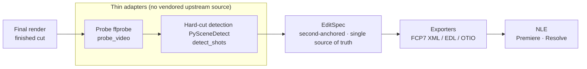

<div align="center">

**English** · [简体中文](README.md)

# RVE: Reverse Video Engineering

### One local MCP server that reverses a finished render into an NLE-importable edit timeline.

**See a finished edit you like. Understand how it was cut, and get back a project you can keep editing.**

[](https://github.com/joker1point/rve/actions)
[](LICENSE)
[](pyproject.toml)

**[Research report](docs/RVE-逆向剪辑调研分析报告.md) · [Contributing](CONTRIBUTING.md) · [Delivery gate](scripts/acceptance.py)**

[Quick start](#quick-start) · [How it works](#how-it-works) · [What you can recover](#what-you-can-recover) · [Showcases](#showcases) · [FAQ](#faq) · [Documentation](#documentation)

<code>git clone https://github.com/joker1point/rve.git &amp;&amp; cd rve &amp;&amp; python -m pip install -e ".[dev]"</code>

</div>

> [!IMPORTANT]
> The only official source for RVE is [github.com/joker1point/rve](https://github.com/joker1point/rve).
> RVE is **not published to PyPI** — do not follow or trust any instruction to `pip install rve`.
> The only installable paths today are **from git source** or **from a locally built wheel**
> (`python -m build --wheel`). A similar repository name or a copied README does not establish
> that a download is official.

<div align="center">

**Final render → probe / shot detection → EditSpec → export (FCP7 / EDL / OTIO) → NLE**

</div>



---

## Why it exists

Existing tools leave a gap for "finished render → a timeline you can keep editing":

- **Hard cuts only**: most shot-splitting tools stop at a list of cut points and do not produce a project an editor can open;
- **Locked to one NLE**: the few tools that export timelines usually target a single editor, with an export layer you cannot swap;
- **Closed**: SaaS that reverse-prompts or reverse-storyboards is proprietary, cannot be self-hosted, and cannot be called directly by an agent.

RVE is positioned as **type C (project reconstruction)**: it wraps mature upstream tools (FFprobe, PySceneDetect, OpenTimelineIO) as **thin adapters** in a single pipeline, produces a **second-anchored** single source of truth `EditSpec`, and exports an importable timeline from it.

> Want to study the rhythm and structure of a finished cut? Ask your agent to take it apart with RVE. Without the original project it returns shot boundaries, rhythm statistics and uncertainty items, shows the evidence, and exports the result as an editable timeline.

RVE hands this to any MCP-capable AI agent over MCP, and also ships a CLI of the same name for terminal use. Analysis runs fully locally, and findings carry their evidence and limits.

---

## Quick start

Prerequisite: **ffmpeg (including ffprobe)** on your `PATH`. Use `rve doctor` to check the environment (it only reports, never fails — `doctor` always exits 0).

### Install

RVE is not on PyPI. The only installable paths today are:

```bash
# Option 1: install from git source (with dev extras)
git clone https://github.com/joker1point/rve.git && cd rve
python -m pip install -e ".[dev]"
```

```bash
# Option 2: install a locally built wheel
python -m build --wheel          # requires pip install build
python -m pip install dist/rve-0.1.0-py3-none-any.whl
```

Either way you get the `rve` command (`[project.scripts]` in `pyproject.toml`, entry point `rve = rve.cli:main`).

Check your environment:

```bash
rve doctor
```

`doctor` probes each external command (`ffprobe`/`ffmpeg`) and Python dependency (`scenedetect`/`opentimelineio`/`mcp`), and prints an actionable install suggestion for anything missing.

### Connect your agent (MCP server)

RVE starts an MCP server over **stdio**, exposing 8 tools (`probe_video`, `detect_shots`, `analyze_audio`, `describe_shots`, `build_edit_spec`, `get_edit_spec`, `export_timeline`, `render_report`) and 1 resource template `editspec://{spec_id}`.

> The CLI has **no** `mcp` subcommand. The standalone MCP server entry point is `python -m rve.mcp.server`.

Add this to the MCP config of Claude Desktop / Cursor / etc.:

```json
{
  "mcpServers": {
    "rve": {
      "command": "python",
      "args": ["-m", "rve.mcp.server"],
      "env": {
        "RVE_WORKSPACES": "C:/Users/<you>/.rve/workspaces"
      }
    }
  }
}
```

- `command`/`args`: start the MCP server over stdio (equivalent to `rve.mcp.server:run_stdio`).
- `env.RVE_WORKSPACES`: the root directory where specs are stored; defaults to `~/.rve/workspaces`. CLI and MCP share one workspace, so a spec produced by an agent can be reused directly by `rve export` / `rve report`.

### Use the terminal

The CLI has exactly 5 subcommands: `doctor` / `analyze` / `export` / `report` / `specs`.

```bash
# 1) One shot: probe -> hard-cut detection -> build EditSpec -> export FCP7 XML
#    Output lands in out/<spec_id>.fcp7xml.xml; the spec is stored in the workspace
rve analyze path/to/final_cut.mp4 --out out/

# 2) List specs already saved in the workspace
rve specs

# 3) Export a spec as an NLE timeline
rve export <spec_id> --format fcp7xml
#    --format values: {fcp7xml, edl, otio}

# 4) Render a human-readable shot review report (HTML)
rve report <spec_id>   # always writes cwd/reports/<spec_id>_report.html, no --out
```

`analyze --engine` accepts `auto` (default, dual-engine cross-check) / `content` / `adaptive`; an unimplemented engine value fails loudly with exit code 2 rather than succeeding silently.

**Exit statuses** (for scripts and agents):

| Exit code | Meaning |
|---|---|
| `0` | Success |
| `2` | Capability not implemented (stderr prints `该能力尚未实现（Phase 2）`); argparse errors are also 2 |
| `1` | Any other exception (stderr prints `错误：<type>: <message>`) |

`doctor` is a health report, not an assertion: it **always exits 0** and never fails because a dependency is missing.

### Update

RVE has **no** self-update mechanism (no `update` subcommand and no npm/npx shim). Update the same way you installed: for a source install run `git pull` and reinstall; for a wheel install rebuild and install the new wheel.

---

## How it works

Your agent calls RVE over MCP; RVE analyzes the material locally, detects shots, assembles `EditSpec` and exports a timeline, with evidence and limits attached to every conclusion. CLI commands use the same pipeline.

RVE mirrors REA's layered organization — three layers, each with one job:

| Layer | Responsibility | Code |
|---|---|---|
| **Workspace / evidence** | One directory per spec, holding `spec.json` and `receipts/`; root set by `RVE_WORKSPACES` | `src/rve/workspace.py` |
| **Session routing** | Exposes "probe → detect → build → export" as 8 MCP tools and 5 CLI subcommands | `src/rve/mcp/server.py`, `src/rve/cli.py` |
| **Provider registry** | Swappable backends: probe (`FfprobeProvider`) and shot detection (`PySceneDetectShotDetector`), declared by `Protocol` | `src/rve/providers/` |

**No vendored upstream source**: RVE does **not** contain or copy any source from FFmpeg, PySceneDetect or OpenTimelineIO. Upstream tools are wrapped as **thin adapters**:

- `ffprobe` is called via a **subprocess** against the `ffprobe` installed on your machine (`src/rve/providers/ffprobe.py`);
- shot detection uses **`import scenedetect`** against the installed PySceneDetect (`src/rve/providers/shots_pyscenedetect.py`);
- OTIO export **imports `opentimelineio` lazily**, so a missing OTIO does not break everything else.

---

## What you can recover

RVE needs Python 3.11/3.12/3.13 plus ffmpeg (including ffprobe). What it can do depends on the target:

| Target | What RVE returns | Requirements and notes |
| --- | --- | --- |
| Local finished render | Source info (duration / fps / resolution / codec / audio) as a `VideoSource` + receipt | Local ffprobe; check with `rve doctor` |
| Hard-cut boundaries | Shot list (second-anchored `in_sec`/`out_sec`), initial `CutType`, dual-engine `disagreements` | PySceneDetect; `analyze --engine {auto,content,adaptive}` |
| Transition (dissolve / fade) detection | Each internal boundary's `cut_type` (`hard`/`dissolve`/`fade`) + transition duration + checkable evidence (peak diff, window baseline, contrast ratio, luminance extremes) | Samples only a ≤1s window around the boundary and never decodes the whole file; insufficient evidence goes into `uncertain[]` — never a silent guess |
| Single source of truth | `EditSpec` (contiguous, non-overlapping, full tiling; `extra="forbid"`; uncertainty into `uncertain[]`) | See [EditSpec contract](#editspec-contract-single-source-of-truth) |
| FCP7 XML timeline | `<xmeml>` sequence; video-track `clipitem`s accumulate along the sequence timeline and tile fully | Pure standard library; `export --format fcp7xml` |
| CMX3600 EDL | One V-track event per shot; record timecode accumulates on the sequence axis | Pure standard library; `export --format edl`; transitions as `C`/`D` + frame count; speed/filters/subtitles not carried |
| OpenTimelineIO | `.otio` intermediate timeline (each clip carries an `ExternalReference` back to the source) | Runtime dependency `opentimelineio` (see `pyproject.toml`); the exporter imports it lazily and exits 2 if missing |
| Human-readable review report | Self-contained single-file HTML (source / rhythm / shot table / transitions / uncertainty) | `rve report <spec_id>`, always writes to `cwd/reports/` |
| Agent orchestration | 8 MCP tools + the `editspec://{spec_id}` resource template | Local stdio MCP server |
| Per-shot audio / visual description | **Not implemented** (Phase 2): `analyze_audio` / `describe_shots` exist as tool names but raise `NotImplementedError` when called | See [Honest limitations](#honest-limitations-phase-0) |

> Note: `analyze_audio` and `describe_shots` are **not implemented**; a tool name existing does not mean the capability works. Unimplemented capabilities always fail loudly — never quietly succeed. Note the split between **export side** and **analysis side**: the FCP7 exporter already writes a real per-shot audio track with `<file>` (see Showcases), while the per-shot audio-analysis / visual-description tools themselves are still missing.

---

## Showcases

All numbers below come from local runs and are reproducible by command.

### Tears of Steel segment: real-material end-to-end recovery

Material is a real segment of Tears of Steel (`ffmpeg -ss 100 -t 60 -c copy`, 1920×800 @ 24fps, 61.808s). Running `rve analyze` produced:

- **10 shots** with `Σ shot duration == source duration == 61.808s` (contiguous, no gaps, no overlaps);
- **~9.707 cuts per minute** (rhythm curve `slow_build`), shortest shot **1.474s**, no sub-0.5s fragments;
- **Transition verdicts**: 9 internal boundaries → **7 hard / 2 dissolve / 0 fade** (each carrying evidence: peak diff, window baseline, contrast ratio);
- **`uncertain == 1`**: the single uncertain item is `shots[9].cut_type` — that dissolve spreads over only 4 frames with confidence 0.42, **explicitly recorded instead of silently guessing a label**.

**On-disk evidence**: the spec's workspace directory holds `spec.json` plus `receipts/` — `receipts/build_edit_spec.json` (this build's receipt and artifact list) and `receipts/transitions.json` (per-boundary evidence for all 9 internal boundaries: peak diff / window baseline / contrast ratio / luminance extremes). Both are offline-checkable files, independent of any transient MCP return.

The exported FCP7 XML, read back by **`scripts/independent_verify.py` (a second implementation that does not import `rve.*`)** → **PASS**: `<xmeml>` version=4, a purely translational timeline (offset ≈ 0 frames across all 10 shots), last clipitem `end=1483` matching `sequence duration=1483`, `<timebase>=24 <ntsc>=FALSE`, **2 `transitionitem`s all strictly straddling their cut points**, an audio track with 10 clipitems, and `<timecode>` present (full output in [Independent verification](#independent-verification)).

OTIO reads back with **10** video clips == the EditSpec shot count, media references intact (`missing_ref == 0`, `no_url == 0`, `target_url` pointing back to the source `tos_seg.webm`), and clip ranges summing to **61.808s == the source duration**. The OTIO audio track is still **empty** (`0` elements) — it does not come along with the FCP7 fix.

Reproduce:

```bash
export RVE_WORKSPACES="$TEMP/rve_vC"
rve analyze /path/to/tos_seg.webm --out "$TEMP/rve_vC/out"
rve export <spec_id> --format fcp7xml --out "$TEMP/rve_vC/out/<spec_id>.fcp7xml"
rve export <spec_id> --format edl
rve export <spec_id> --format otio
```

### Delivery gate: 11/11 PASS

`python scripts/acceptance.py` is the delivery gate. It prints PASS/FAIL per stage, ends with `RESULT: PASS|FAIL`, and only exits 0 when everything passes. Eleven stages: S0 preflight / S1 host tests / S2 build wheel + install into a fresh venv + `rve --help`/`doctor` / **S2b tests inside the fresh venv** / S3 hermetic end-to-end `analyze` / S4 FCP7 XML contract assertion / S5 EDL+OTIO+round-trip / S6 MCP surface / S7 open-source hygiene / S8 package-name gate / **S9 independent check (a second implementation that does not import `rve` reads the FCP7 XML back)**.

Most recent local run:

```text
通过 11 / 失败 0 / 跳过 0
RESULT: PASS
```

where S1 host tests reported `passed=91 skipped=4 failed=0 errors=0` (all 4 skips are the OTIO cases skipped by convention when the host lacks `opentimelineio`), S2b tests inside the fresh venv reported `passed=95 skipped=0 failed=0 errors=0` (the fresh environment has every dependency, so the OTIO cases all run), and S9's independent verifier exited `0` with verdict `PASS`.

> **Why S9 deserves its own stage**: S4's FCP7 contract assertions are executed by **the very same code that writes the XML** — that is self-verification, so the gate stays green even if the exporter and the assertions share the same wrong assumption. S9 swaps in a second implementation (`scripts/independent_verify.py`) that does not import `rve.*`, rebuilds the timeline from first principles, and compares — blocking exactly this class of systemic blind spot. See [Independent verification](#independent-verification).

---

## Independent verification

Half of the gate's conclusions are produced by RVE itself, which limits how much they prove. RVE therefore adds two evidence chains **independent of its own implementation**:

**1. A second implementation reads the output back.** `scripts/independent_verify.py` uses only the Python standard library and **never imports `rve.*`** (a constraint pinned by a source-level regex in `tests/test_independent_verify.py`). Following the public `xmeml` conventions, it rebuilds the "source frame → sequence frame" mapping from first principles and compares it shot by shot against `spec.json`: timeline continuity, frame rate, `sequence duration`, transition straddle, and the audio track. Gate stage **S9** runs exactly this — the final `RESULT` is decided jointly by two implementations that **share no assumptions**.

**2. Benchmarking against real NLE output.** Nine `xmeml` files exported by real NLEs (5 Premiere, 1 FCP7/Hiero, 3 third-party goldens) are used to check whether the reader can swallow real-world shapes, and to list the structural differences between "real output" and "RVE output" item by item. The samples and conclusions live in [`scripts/independent_verify_findings.md`](scripts/independent_verify_findings.md) (samples are kept only in a local temp directory and are **not committed** — copyright risk).

Results from this run:

| Subject | Result |
|---|---|
| RVE real output (FCP7 XML exported from the Tears of Steel segment) | **PASS** — purely translational timeline, contiguous with no gaps/overlaps, `sequence duration` as expected, 2 `transitionitem`s all strictly straddling their cut points, audio track with 10 clipitems |
| Nine real NLE samples (structural mode) | **9/9 PASS** — the reader swallows real-world shapes |
| `tests/test_independent_verify.py` | **12 passed** (including "hand-made broken XML with a gap/overlap must fail" and "CLI exits non-zero") |

**Honest boundaries.** The benchmark also surfaced 3 **undecided** differences, and their effect on **actual import behaviour** has not been human-tested, so **nothing was changed on a guess** this round — they are only recorded:

1. `<clipitem><duration>` semantics — real output is **internally inconsistent** (some write the total source duration, some write the segment length); RVE writes the segment length, matching one of the camps, so this cannot be used to call RVE non-compliant;
2. `<timecode>` lacks a `<source>` child — real output usually has it, but most NLEs tolerate its absence; whether it is required is untested;
3. audio clipitems lack the `<link>` cross-link to video — real output usually has it; whether it is required is untested.

---

## EditSpec contract (single source of truth)

`EditSpec` is the central artifact of the whole pipeline, enforced by `src/rve/schema/editspec.py`:

- **Purely second-anchored**: every time field is in seconds (`in_sec`/`out_sec`/`duration_sec`…), and **no timecode is stored**. The only seconds↔timecode conversion happens inside `src/rve/exporters/`, a single source of truth.
- **`extra="forbid"`**: all models inherit from `Strict`, so unknown fields are rejected — preventing silent schema drift (and serving as an interface anti-drift lock during parallel work).
- **Shot tiling invariant**: `shots` must be **contiguous, non-overlapping, and tile the whole timeline**, or validation fails and output is refused. This invariant is the interception point for "holes or overlaps after importing into an NLE".
- **Uncertainty made explicit**: uncertain conclusions go into `uncertain[]`; defaults are not used to paper over them.

---

## Export formats

| Format | `--format` | Status | Notes |
|---|---|---|---|
| FCP7 XML | `fcp7xml` | ✅ Implemented | Pure standard library (`xmeml`); the v1 primary output |
| CMX3600 EDL | `edl` | ✅ Implemented | Pure standard library; one V-track event per shot, transitions as `D` + frame count |
| OpenTimelineIO | `otio` | ✅ Implemented | Runtime dependency `opentimelineio` (see `pyproject.toml`); an intermediate layer for later extension to more native NLE formats |

CLI `--format` accepts only the three values above (`_EXPORT_FORMATS` in `cli.py`); the same three are reachable through MCP `export_timeline`. Unimplemented values **fail loudly instead of producing a half-baked file** — a hard rule for RVE: never quietly succeed.

---

## Honest limitations (Phase 0)

RVE only stands behind what it can verify. The table below spells out what it does **not** promise:

| Capability | Status |
|---|---|
| Hard-cut boundaries | ✅ Implemented (`content`/`adaptive` dual-engine cross-check; disagreements are explicit) |
| Transition (dissolve / fade) detection | ⚠️ **Detection side implemented** (`dissolve`/`fade`, sampling only a ≤1s window around the boundary, with evidence and confidence per verdict) and covered by tests; on the **export side** it writes `<transitionitem>` strictly straddling the cut point. Real material still yields boundaries with **weak evidence** (the Tears of Steel segment: 9 boundaries → 1 in `uncertain`); the `effectid`/`effectcategory` values and **import correctness still need real-world testing** |
| **NLE import closure** | ⚠️ **The only unclosed acceptance item**: a real import into Premiere / Resolve **has not been tested**; "a file was produced" is not the same as passing. S9's independent check and the 9-sample real-NLE benchmark (see [Independent verification](#independent-verification)) verify **structure**, not an NLE's actual acceptance |
| Audio-track recovery | ⚠️ Partial: the **FCP7 exporter now writes a real per-shot audio track with `<file>`** (Tears of Steel segment → 10 audio clipitems, appearing/disappearing with `has_audio`); but the **OTIO audio track is still empty**, the audio↔video `<link>` cross-link is not written, and per-shot audio **analysis** (`analyze_audio`) is still not implemented |
| Speed ramps / filters / subtitles / OCR / VLM descriptions | ⛔ Not in place (Phase 2) |

---

## FAQ

<details>
<summary><strong>Which agents can use RVE?</strong></summary>

Any agent that supports local MCP servers. RVE starts over stdio at `python -m rve.mcp.server`; register it in your agent's MCP config (see [Connect your agent](#connect-your-agent-mcp-server)).

</details>

<details>
<summary><strong>What do I need installed first?</strong></summary>

Python 3.11/3.12/3.13 plus **ffmpeg (including ffprobe)** on your `PATH`. `scenedetect`, `mcp` and `opentimelineio` are all runtime dependencies (`dependencies` in `pyproject.toml`) installed with the package. Run `rve doctor` first.

</details>

<details>
<summary><strong>Can I install rve from PyPI?</strong></summary>

No. RVE is not published to PyPI; do not trust any instruction to `pip install rve`. Today you can only install from git source or from a locally built wheel.

</details>

<details>
<summary><strong>Does RVE upload my video?</strong></summary>

No. RVE analyzes locally; only your agent receives the tool results, and your model provider has its own data policy.

</details>

<details>
<summary><strong>Can the exported timeline be imported into Premiere / Resolve directly?</strong></summary>

FCP7 XML is the primary output and satisfies the `xmeml` contract (the delivery gate's S4 passes fully), but a **real import into Premiere / Resolve has not yet been performed** — the only unclosed acceptance item today. EDL carries no speed, filters or subtitles (transitions appear as `D` + frame count) and is only a minimal-path check; OTIO is an intermediate layer.

</details>

<details>
<summary><strong>Why does an unimplemented format fail loudly instead of doing its best?</strong></summary>

Because a half-baked file that cannot be imported is worse than a clear error. RVE's rule is "failure must be visible": unimplemented capabilities fail with exit code 2 and never quietly succeed.

</details>

<details>
<summary><strong>A capability looks supported but reports "not implemented"?</strong></summary>

`analyze_audio`, `describe_shots` and similar tool names are registered, but their implementation is Phase 2 and calling them raises `NotImplementedError`. A registered tool name does not mean the capability works — see [Honest limitations](#honest-limitations-phase-0).

</details>

---

## Documentation

Start inside the repository:

- [Research report](docs/RVE-逆向剪辑调研分析报告.md): why the project converged on type C and how it is positioned (Chinese).
- [Contributing](CONTRIBUTING.md): development setup, tests, PR order and hard rules (Chinese).
- [Delivery gate](scripts/acceptance.py): the eleven-stage gate, ending with `RESULT: PASS|FAIL`.
- [Independent verifier](scripts/independent_verify.py) and [real-NLE benchmark findings](scripts/independent_verify_findings.md): a second implementation that does not import `rve`, plus the structural-difference list over 9 real samples.
- [CI](.github/workflows/ci.yml): ubuntu-latest, Python 3.11/3.12/3.13 matrix.
- [EditSpec contract](#editspec-contract-single-source-of-truth) and [Export formats](#export-formats): structural invariants and per-format status.

---

## Star history

RVE is young. If it is useful to you, a Star is appreciated.

<a href="https://www.star-history.com/?repos=joker1point%2Frve&amp;type=date">
  <picture>
    <source media="(prefers-color-scheme: dark)" srcset="https://api.star-history.com/svg?repos=joker1point/rve&amp;type=Date&amp;theme=dark" />
    <source media="(prefers-color-scheme: light)" srcset="https://api.star-history.com/svg?repos=joker1point/rve&amp;type=Date" />
    
  </picture>
</a>

---

## Disclaimer

RVE is for lawful research, learning and edit-timeline reconstruction of videos **you own or are authorized to examine**. Do not use it on content you have no right to analyze.

RVE grants no license and carries no rights to any upstream tool (FFmpeg, PySceneDetect, OpenTimelineIO, etc.); their use is subject to their own terms.

## Contributing

We'd love your help! [Open an issue](https://github.com/joker1point/rve/issues) to report a bug or suggest a feature, or [send a pull request](https://github.com/joker1point/rve/pulls) to improve code or docs.

Read [CONTRIBUTING.md](CONTRIBUTING.md) first and follow the hard rules: **no vendored upstream source**, **the EditSpec contract must not loosen**, and **failure must not be swallowed**.

## License

[MIT](LICENSE).

RVE-authored code is MIT-licensed. Third-party material retains its own licenses and copyright notices.
