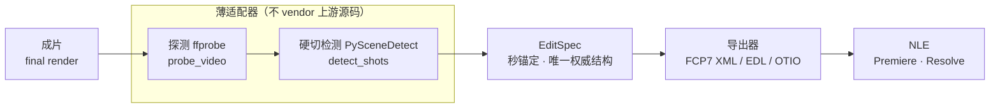

<div align="center">

[English](README.en.md) · **简体中文**

# RVE：Reverse Video Engineering

### 一个本地 MCP Server，把「已成片」逆向还原为可导入 NLE 的编辑时间线。

**看到一条喜欢的成片。想知道它怎么剪的，并拿回一份能继续编辑的工程。**

[](https://github.com/joker1point/rve/actions)
[](LICENSE)
[](pyproject.toml)

**[调研分析报告](docs/RVE-逆向剪辑调研分析报告.md) · [贡献指南](CONTRIBUTING.md) · [交付验收](scripts/acceptance.py)**

[快速开始](#快速开始) · [工作原理](#工作原理) · [能还原什么](#能还原什么能力矩阵) · [Showcases](#showcases) · [案例库](#案例库showcase-library) · [模拟真人导入](#模拟真人导入无-nle-环境下的代理验收) · [FAQ](#faq) · [文档](#文档)

<code>git clone https://github.com/joker1point/rve.git &amp;&amp; cd rve &amp;&amp; python -m pip install -e ".[dev]"</code>

</div>

> [!IMPORTANT]
> RVE 的官方来源只有 [github.com/joker1point/rve](https://github.com/joker1point/rve)。
> RVE **尚未发布到 PyPI** —— 请勿相信任何 `pip install rve` 的指引。当前可行的安装方式只有两种：
> **从 git 安装源码**，或**安装本地构建的 wheel**（`python -m build --wheel`）。
> 相似的仓库名或照抄的 README 都不能说明下载是官方的。

<div align="center">

**成片 → 探测/切镜 → EditSpec → 导出（FCP7 / EDL / OTIO）→ NLE**

</div>



---

## 为什么存在

现有工具覆盖不到「成片 → 可继续编辑的时间线」这一格：

- **只能还原硬切**：多数镜头切分工具止步于"切点列表"，不产出能被剪辑软件吃下的工程；
- **绑死单一 NLE**：能导出时间线的少数方案往往只对接某一家剪辑软件，导出层不可替换；
- **封闭**：反推提示词/分镜的 SaaS 是闭源服务，无法自托管、也无法被 Agent 直接调用。

RVE 的定位是 **C 型（工程还原）**：把成熟的上游工具（FFprobe、PySceneDetect、OpenTimelineIO）以**薄适配器**封装成统一流水线，产出**秒锚定**的唯一权威结构 `EditSpec`，再从它导出可导入的时间线。

> 想研究一条成片的节奏与结构？让 Agent 用 RVE 拆开它。它不需要源工程，就能给出镜头边界、节奏统计与存疑项，输出证据，并把结论导出成可编辑的时间线。

RVE 通过 MCP 把上述能力交给任意支持 MCP 的 AI Agent，同时提供同名 CLI 供你在终端直接调用。分析全程本地完成，结论附带证据与限制说明。

---

## 快速开始

前置条件：本机需装 **ffmpeg（含 ffprobe）** 并加入 `PATH`。用 `rve doctor` 确认环境（缺依赖时只报告、不报错，`doctor` 永远退出 0）。

### 安装

RVE 尚未发布到 PyPI。当前可行的安装方式只有两种：

```bash
# 方式一：从 git 安装源码（含开发依赖）
git clone https://github.com/joker1point/rve.git && cd rve
python -m pip install -e ".[dev]"
```

```bash
# 方式二：安装本地构建的 wheel
python -m build --wheel          # 需 pip install build
python -m pip install dist/rve-0.1.0-py3-none-any.whl
```

安装后即得到 `rve` 命令（`pyproject.toml` 的 `[project.scripts]`，入口 `rve = rve.cli:main`）。

自检本机环境：

```bash
rve doctor
```

`doctor` 会逐项探测外部命令（`ffprobe`/`ffmpeg`）与 Python 依赖（`scenedetect`/`opentimelineio`/`mcp`），并打印缺失项的可执行安装建议。

### 接入你的 Agent（MCP Server）

RVE 以 **stdio** 传输启动 MCP server，对外暴露 8 个工具（`probe_video`、`detect_shots`、`analyze_audio`、`describe_shots`、`build_edit_spec`、`get_edit_spec`、`export_timeline`、`render_report`）与 1 个资源模板 `editspec://{spec_id}`。

> CLI **没有** `mcp` 子命令。MCP server 的独立入口是 `python -m rve.mcp.server`。

在 Claude Desktop / Cursor 等的 MCP 配置中加入：

```json
{
  "mcpServers": {
    "rve": {
      "command": "python",
      "args": ["-m", "rve.mcp.server"],
      "env": {
        "RVE_WORKSPACES": "C:/Users/<you>/.rve/workspaces"
      }
    }
  }
}
```

- `command`/`args`：以 stdio 启动 MCP server（等价于 `rve.mcp.server:run_stdio`）。
- `env.RVE_WORKSPACES`：spec 落盘根目录；缺省 `~/.rve/workspaces`。CLI 与 MCP 共用同一工作区，Agent 产出的 spec 可被 `rve export`/`rve report` 直接复用。

### 用终端

CLI 只有 5 个子命令：`doctor` / `analyze` / `export` / `report` / `specs`。

```bash
# 1) 一条龙：探测 -> 硬切检测 -> 组装 EditSpec -> 导出 FCP7 XML
#    产物落在 out/<spec_id>.fcp7xml.xml，同时 spec 已存入工作区
rve analyze path/to/final_cut.mp4 --out out/

# 2) 列出工作区中已保存的 spec
rve specs

# 3) 把某个 spec 导出为 NLE 时间线
rve export <spec_id> --format fcp7xml
#    --format 取值：{fcp7xml, edl, otio}

# 4) 渲染人类可读的分镜复核报告（HTML）
rve report <spec_id>   # 固定写到 cwd/reports/<spec_id>_report.html，无 --out
```

`analyze` 的 `--engine` 可选 `auto`（默认，双引擎交叉验证）/`content`/`adaptive`；未实现的引擎取值会以退出码 2 明确报错，不会静默成功。

**退出码约定**（供脚本与 Agent 判断）：

| 退出码 | 含义 |
|---|---|
| `0` | 成功 |
| `2` | 能力尚未实现（stderr 打印 `该能力尚未实现（Phase 2）`）；argparse 参数错误同样是 2 |
| `1` | 其他异常（stderr 打印 `错误：<类型>: <信息>`） |

`doctor` 是"体检报告"而非"断言"，**永远退出 0**，不因缺依赖而失败。

### 更新

RVE **没有**自更新机制（没有 `update` 子命令，也没有 npm/npx 薄壳）。更新方式与安装一致：对源码安装执行 `git pull` 后重装，对 wheel 安装重新构建并安装新 wheel。

---

## 工作原理

你的 Agent 通过 MCP 调用 RVE，RVE 在本地探测素材、切分镜头、组装 `EditSpec` 并导出时间线；结论附带证据与限制。CLI 命令走的是同一套流水线。

<picture>
  <source media="(prefers-color-scheme: dark)" srcset="docs/assets/rve-how-it-works.dark.svg">
  
</picture>

RVE 照 REA 的分层组织，三层各司其职：

| 层 | 职责 | 代码位置 |
|---|---|---|
| **工作区 / 证据目录** | 每个 spec 一个目录，内 `spec.json` 与 `receipts/`；根目录由 `RVE_WORKSPACES` 指定 | `src/rve/workspace.py` |
| **会话路由** | 把「探测 → 切镜 → 组装 → 导出」暴露成 10 个 MCP 工具与 6 个 CLI 子命令 | `src/rve/mcp/server.py`、`src/rve/cli.py` |
| **Provider 注册表** | 可替换后端：探针（`FfprobeProvider`）与切镜（`PySceneDetectShotDetector`），以 `Protocol` 声明契约 | `src/rve/providers/` |

**不 vendor 任何上游源码**：RVE **不包含**、也不复制 FFmpeg、PySceneDetect、OpenTimelineIO 的任何源码。上游工具一律以**薄适配器**封装：

- `ffprobe` 通过**子进程**调用用户机器上已安装的 `ffprobe`（`src/rve/providers/ffprobe.py`）；
- 切镜通过 **`import scenedetect`** 调用已安装的 PySceneDetect（`src/rve/providers/shots_pyscenedetect.py`）；
- OTIO 导出**延迟导入** `opentimelineio`，因此未装 OTIO 也不会拖垮其余功能。

---

## 能还原什么（能力矩阵）

RVE 需要 Python 3.11/3.12/3.13，外加 ffmpeg（含 ffprobe）。能做什么取决于目标：

| 目标 | RVE 返回什么 | 要求与说明 |
| --- | --- | --- |
| 本地成片 | 时长/帧率/分辨率/编码/音轨的源信息（`VideoSource` + receipt） | 本机 ffprobe；`rve doctor` 自检 |
| 硬切镜头边界 | 镜头列表（秒锚定 `in_sec`/`out_sec`）、`CutType` 初判、双引擎分歧 `disagreements` | PySceneDetect；`analyze --engine {auto,content,adaptive}` |
| 转场（溶解 / 淡入淡出）识别 | 每条内部边界的 `cut_type`（`hard`/`dissolve`/`fade`）+ 渐变时长 + 可复核证据（峰值差、基线、信噪比、亮度极值） | 只采边界附近 ≤1s 窗口、不解码整片；证据不足进 `uncertain[]`，绝不静默猜 |
| 唯一权威结构 | `EditSpec`（连续无重叠铺满、`extra="forbid"`、存疑进 `uncertain[]`） | 见 [EditSpec 契约](#editspec-契约唯一权威结构) |
| FCP7 XML 时间线 | `<xmeml>` 序列，video 轨 `clipitem` 按序列时间轴累积铺满 | 纯标准库；`export --format fcp7xml` |
| CMX3600 EDL | 每镜一条 V 轨事件，录机端时间码在序列轴上累积 | 纯标准库；`export --format edl`；转场以 `C`/`D`+帧数表达，变速/滤镜/字幕不承载 |
| OpenTimelineIO | `.otio` 中间层时间线（每个 clip 挂 `ExternalReference` 回源素材） | 运行期依赖 `opentimelineio`（见 `pyproject.toml`）；导出器延迟导入，缺包时 exit 2 |
| 人类可读复核报告 | 自包含单文件 HTML（源素材 / 节奏统计 / 镜头表 / 转场 / 存疑告警） | `rve report <spec_id>`，固定写 `cwd/reports/` |
| 案例库 | 案例配方清单 + 逐项校验结果（期望 vs 实测） | `rve showcase list/run`；MCP `list_showcases`/`run_showcase` |
| Agent 编排 | 10 个 MCP 工具 + `editspec://{spec_id}` 资源模板 | 本地 stdio MCP server |
| 逐镜音频 / 画面描述 | **未实现**（Phase 2）：`analyze_audio` / `describe_shots` 工具名存在，但调用即 `NotImplementedError` | 见 [诚实的局限](#诚实的局限phase-0) |

> 说明：`analyze_audio` 与 `describe_shots` 两个工具**未落地**，工具名存在不代表能力可用；未实现的能力一律显式报错，绝不 quietly succeed。注意区分**导出侧**与**分析侧**：FCP7 导出已输出带真实 `<file>` 的逐镜音频轨（见 Showcases），而"逐镜音频分析/画面描述"工具本身仍未实现。

---

## Showcases

以下指标均由本机实跑产出，命令可复现。

### Tears of Steel 片段：真实素材全链路还原

素材为 Tears of Steel 的真实片段（`ffmpeg -ss 100 -t 60 -c copy` 截取，1920×800 @ 24fps，61.808s）。运行 `rve analyze` 得到：

- **10 个镜头**，`Σ镜头时长 == 源时长 == 61.808s`（连续、无缺口、无重叠）；
- **每分钟约 9.707 个切点**（节奏曲线 `slow_build`），最短镜头 **1.474s**，无 `< 0.5s` 碎镜；
- **转场判定**：9 条内部边界 → **7 硬切 / 2 溶解 / 0 淡出**（每条都带峰值差、窗口基线、信噪比等证据）；
- **`uncertain == 1`**：唯一存疑项是 `shots[9].cut_type`——那条溶解只有 4 帧铺展、置信度 0.42，**显式登记而非静默猜一个标签**。

**落盘证据**：该 spec 的工作区目录含 `spec.json` 与 `receipts/`——`receipts/build_edit_spec.json`（本次组装的回执与产物清单）与 `receipts/transitions.json`（9 条内部边界的**逐条**证据：峰值差 / 窗口基线 / 信噪比 / 亮度极值）。二者均为离线可复核文件，不依赖 MCP 的瞬时返回。

导出的 FCP7 XML 经 **`scripts/independent_verify.py`（不 import `rve.*` 的第二实现）** 回读 → **PASS**：`<xmeml>` version=4、时间轴为纯平移（偏移 ≈ 0 帧、跨 10 镜一致）、末个 clipitem `end=1483` 且 `sequence duration=1483` 与期望一致、`<timebase>=24 <ntsc>=FALSE`、**2 个 `transitionitem` 全部严格跨骑剪切点**、音频轨 10 个 clipitem、`<timecode>` 存在（详细输出见[独立验证](#独立验证回应自证式验证)）。

OTIO 读回：视频轨 clip 数 **10** == EditSpec 镜头数，媒体引用齐全（`missing_ref == 0`、`no_url == 0`，`target_url` 回指源 `tos_seg.webm`），镜头区间之和 **61.808s == 源时长**。OTIO 的音频轨目前仍为**空轨**（`0` 个元素），不随 FCP7 一起补齐。

复现命令：

```bash
export RVE_WORKSPACES="$TEMP/rve_vC"
rve analyze /path/to/tos_seg.webm --out "$TEMP/rve_vC/out"
rve export <spec_id> --format fcp7xml --out "$TEMP/rve_vC/out/<spec_id>.fcp7xml"
rve export <spec_id> --format edl
rve export <spec_id> --format otio
```

### 交付闸门：13/13 PASS

`python scripts/acceptance.py` 是交付验收入口，逐阶段打印 PASS/FAIL，末行输出 `RESULT: PASS|FAIL`，全过才 exit 0。十三个阶段：S0 预检 / S1 宿主单测 / S2 构建 wheel + 全新 venv 安装 + `rve --help`/`doctor` / **S2b 全新 venv 内单测** / S3 密闭端到端 `analyze` / S4 FCP7 XML 契约断言 / S5 EDL+OTIO+往返 / S6 MCP 面 / S7 开源卫生 / S8 包名闸门 / **S9 独立校验（不 import `rve` 的第二实现回读 FCP7 XML）** / **S10 案例库（全新 venv 内 `rve showcase list` + 跑通程序合成案例）** / **S11 模拟真人导入（真值素材 + 独立解析器回读比对）**。

最近一次本机实跑：

```text
通过 13 / 失败 0 / 跳过 0
RESULT: PASS
```

其中 S1 宿主单测与 S2b 全新 venv 内单测均为 `passed=125 skipped=0 failed=0 errors=0`（宿主与全新环境依赖齐备，OTIO 用例全部执行；宿主若未装 `opentimelineio`，那几条 OTIO 用例按约定 skip 而非报错），S9 独立校验器退出码 `0`、裁决 `PASS`，S10 在全新 venv 内 `rve showcase list` 命中全部 4 个案例 id 并跑通程序合成案例，S11 模拟真人导入 9/9 通过（时间线总长 216 帧 = 7.200s、3 处硬切全部命中、2 处转场落在设计窗口内、6 个片段素材全部在线）。

> **S9 为什么必须单列**：S4 的 FCP7 契约断言由**写 XML 的同一份代码**执行，属**自证**——导出器与断言共享同一个错误假设时，闸门照绿。S9 换用一个不 import `rve.*` 的第二实现（`scripts/independent_verify.py`），从第一性原理重建时间轴再比对，专挡这类系统性盲区。详见[独立验证](#独立验证回应自证式验证)。

---

## 案例库（Showcase Library）

案例库把「跑出来是什么样」固化成**可复现、可校验的配方**。每个案例是一份 `case.json`（随包分发），写清素材从哪来、怎么准备、期望指标是什么；`rve showcase run <id>` 会真的跑一遍主链路，把实测值与期望值**逐项比对**——对不上就是失败，不静默放过。

```bash
rve showcase list                                          # 列出全部案例
rve showcase run synth_hard_cut                            # 跑一个程序合成案例（零版权，CI 可跑）
rve showcase run tos_segment --material /path/to/tos.mp4    # 外部素材需自行准备
```

| 案例 | 素材 | 许可 | 期望（实测口径） |
|---|---|---|---|
| `synth_hard_cut` | ffmpeg 现场合成（纯红 + SMPTE 彩条硬切） | CC0-1.0 | 2 镜 / 1 硬切 / 4.000s |
| `synth_dissolve` | ffmpeg 现场合成（`xfade` 溶解） | CC0-1.0 | 2 镜 / 1 溶解 / 3.500s |
| `synth_fade` | ffmpeg 现场合成（`fade` 淡出到黑） | CC0-1.0 | 2 镜 / 1 淡出 / 5.000s |
| `tos_segment` | Tears of Steel 片段（**素材不入库**，需自行下载） | CC-BY 3.0 | 10 镜 / 7 硬切 + 2 溶解 / 61.808s / `uncertain=1` |

期望值全部来自本机实跑（ffmpeg 4.3.1 + scenedetect 0.7.2），不是估计值；`tos_segment` 一行取自上面 Showcases 段记录的同一条截取命令的实跑结果。

两条刻意的设计：

- **合成素材的配方就是可直接执行的 ffmpeg 命令行**（`{{out}}` 为输出占位符），因此三个合成案例不依赖任何第三方素材文件，CI 随时可跑；
- **外部素材绝不自动联网下载**：缺素材时命令会打印「怎么准备」（来源、许可、截取命令、放置位置）并以退出码 2 结束，不静默跳过。

案例通过 MCP 同样可调：`list_showcases` 列出全部，`run_showcase` 跑单个并返回逐项校验结果。

---

## 独立验证（回应"自证式验证"）

交付闸门里有一半结论只由 RVE 自己产出，说服力有限。为此 RVE 加了两条**独立于自身实现**的证据链：

**1. 第二实现回读。** `scripts/independent_verify.py` 只依赖 Python 标准库、**绝不 import `rve.*`**（该约束由 `tests/test_independent_verify.py` 用源码正则钉死），按公开 `xmeml` 约定从第一性原理重建"源帧 → 序列帧"映射，再与 `spec.json` 逐镜比对时间轴连续性、帧率、`sequence duration`、转场跨骑与音频轨。闸门 **S9** 即跑它——最终 `RESULT` 由两份**不共享假设**的实现共同决定。

**2. 真实 NLE 产物对标。** 取 9 份真实 NLE 导出的 `xmeml`（Premiere 5 份 / FCP7·Hiero 1 份 / 第三方金标 3 份），检验读取器能否吃下真实形态，并逐条列出「真实产物 vs RVE 产物」的结构差异。样本与结论见 [`scripts/independent_verify_findings.md`](scripts/independent_verify_findings.md)（样本只存本机临时目录，**不入库**——版权风险）。

本次实跑结果：

| 对象 | 结果 |
|---|---|
| RVE 真实产物（Tears of Steel 片段导出的 FCP7 XML） | **PASS**——时间轴纯平移、连续无空洞/重叠、`sequence duration` 与期望一致、2 个 `transitionitem` 全部严格跨骑剪切点、音频轨 10 个 clipitem |
| 9 份真实 NLE 样本（结构模式） | **9/9 PASS**——读取器可吃下真实形态 |
| `tests/test_independent_verify.py` | **12 passed**（含"手工坏 XML 空洞/重叠必须失败"与"CLI 非零退出"） |

**诚实边界。** 对标同时暴露 3 项**未定论**差异，且它们对**真实导入行为**的影响未经真人实测，故**本轮不凭猜修改**，只登记在案：

1. `<clipitem><duration>` 口径——真实产物**自身就不统一**（有的写素材总时长、有的写本段长度），RVE 写"本段长度"，与其中一派一致，不能据此判定不合规；
2. `<timecode>` 缺 `<source>` 子元素——真实产物普遍有，但多数 NLE 容忍，是否必需未实测；
3. 音频 clipitem 缺 `<link>` 与视频互链——真实产物普遍有，是否必需未实测。

---

## 模拟真人导入（无 NLE 环境下的代理验收）

本项目唯一**无法在仓库内闭环**的验收项，是「真人在 Premiere / Resolve 里导入 FCP7 XML，打开时间线面板，核对镜头数 / 总时长 / 转场数」——本机没有任何 NLE，CI 也是 headless。

RVE 的做法是**换基准，而不是降低断言**：用 ffmpeg 造一段**真值在设计期就完全已知**的合成素材，再让一个**不 import `rve.*` 的独立解析器**站在 NLE 的位置只吃 XML 重建时间线，逐项与素材的设计真值比对。

```bash
python scripts/make_nle_ground_truth.py --out /tmp/fixture      # 造素材 + 真值
rve analyze /tmp/fixture/nle_fixture.mp4 --out /tmp/out        # 产出 FCP7 XML
python scripts/simulate_nle_import.py /tmp/out/*.fcp7xml.xml \
    --expect /tmp/fixture/ground_truth.json --html /tmp/panel.html
```

素材设计（30fps，帧数精确可算）：纯红 2.0s → SMPTE 彩条 1.5s → 纯绿 1.2s → 纯蓝 1.0s → 纯黄 1.0s（**0.5s 溶解**）→ 纯黑 1.0s（**0.5s 淡出**），总长 **7.2s / 216 帧**。

真值用**内容事件**表述，而不是「镜头起点」：3 处硬切点 + 2 段转场时间窗。因为渐变区算前一镜、算后一镜、还是单独成一镜，本身是**约定而非事实**——把它当断言会一碰就碎；而「硬切点必须出现在 X」「转场必须落在 X 这段时间窗里」是素材侧不容争辩的事实。

模拟器逐项核对的，正是人工在时间线面板上会看的那几件事：

| 核对项 | 判据 |
|---|---|
| 时间线总长 | 与设计总长一致（±0.05s） |
| 片段数 | 落在「硬切数 + 1 ~ +2」区间（渐变区归属浮动） |
| 硬切点位置 | 3 处硬切点必须全部出现在时间线边界上（±0.1s） |
| 转场类型与时间窗 | 每个设计的转场窗内必须有一个同类型的 `transitionitem`（窗口外扩 ±0.5s） |
| 素材链接可用 | 每个片段的 `<file>` 都指向磁盘上真实存在的文件（媒体离线是导入最常见的失败） |
| 音轨对齐 | 音频片段数与视频片段数一致 |
| 结构自检 | 片段首尾相接无空洞/重叠、序列时长自洽、转场严格跨骑剪切点 |

本机实跑：**9/9 全部通过**——总长 216 帧 = 7.200s、3 处硬切全部命中、2 处转场均落在设计窗口内、6 个片段素材全部在线、音轨 6 对 6。`--html` 会产出一份可单独打开的**时间线面板**（视频轨 + 音轨 + 转场标记 + 核对表），用来替代「真人打开面板看一眼」那一步。

> ⚠️ **这条证据链验证什么、不验证什么**
> 它验证：**FCP7 XML 的时间线语义能被一个独立实现正确重建，且与素材的设计真值一致**。
> 它**不**验证：Premiere / Resolve 会不会接受这个 XML、会不会自动裁剪转场两侧的片段、`effectid` 取值会不会被正确识别。
> 真 NLE 导入仍需人工在装有 Premiere/Resolve 的机器上执行一次——步骤见 [FAQ](#faq)。

---

## EditSpec 契约（唯一权威结构）

`EditSpec` 是整条流水线的中心产物，契约由 `src/rve/schema/editspec.py` 强制：

- **纯时间锚定**：所有时间字段都是秒（`in_sec`/`out_sec`/`duration_sec`…），**不存时间码**。秒↔时间码的唯一换算发生在 `src/rve/exporters/` 内，形成单一事实来源。
- **`extra="forbid"`**：所有结构模型继承自 `Strict`，未知字段一律拒绝 —— 防止 schema 静默漂移（这也是并发协作时的接口防漂移锁）。
- **镜头铺满不变量**：`shots` 必须**连续、无重叠、铺满整条时间轴**，否则校验失败、拒绝产出。这条不变量正是"导出到 NLE 后出现空洞或重叠"的根因拦截点。
- **存疑显式化**：拿不准的结论进 `uncertain[]`，不用默认值蒙混。

---

## 导出格式

| 格式 | `--format` | 状态 | 说明 |
|---|---|---|---|
| FCP7 XML | `fcp7xml` | ✅ 已实现 | 纯标准库实现（`xmeml`），是 v1 主出口 |
| CMX3600 EDL | `edl` | ✅ 已实现 | 纯标准库实现；逐镜一条 V 轨事件，转场用 `D`+帧数 |
| OpenTimelineIO | `otio` | ✅ 已实现 | 运行期依赖 `opentimelineio`（见 `pyproject.toml`）；作为中间层，便于后续扩展到更多 NLE 原生格式 |

CLI `--format` 只接受上面三个取值（`cli.py` 的 `_EXPORT_FORMATS`）；同样这三个也通过 MCP `export_timeline` 触达。未实现的取值**显式报错而非产出半成品**——这是 RVE 的硬规矩：绝不 quietly succeed。

---

## 诚实的局限（Phase 0）

RVE 只对能验证的事负责。下表把「不可承诺项」说清：

| 能力 | 现状 |
|---|---|
| 硬切镜头边界 | ✅ 已实现（`content`/`adaptive` 双引擎交叉验证，分歧显式写入） |
| 转场（溶解/淡入淡出）识别 | ⚠️ **检测侧已实现**（`dissolve`/`fade`，只采边界附近 ≤1s 窗口，逐条给证据与置信度），单测覆盖；**导出侧**写 `<transitionitem>` 且严格跨骑剪切点。真实素材仍会有**证据偏弱**的边界（Tears of Steel 片段 9 条边界 → 1 条进 `uncertain`）；`effectid`/`effectcategory` 取值与**导入正确性仍需真人实测** |
| **NLE 导入闭环** | ⚠️ **唯一未闭环验收项**：Premiere / Resolve **真导入并还原时间线尚未实测**；"生成了文件"不等于通过。已加 S9 独立校验与 9 份真实 NLE 产物对标（见[独立验证](#独立验证回应自证式验证)），但它们验的是**结构**，不是 NLE 的实际接受度 |
| 音轨还原 | ⚠️ 部分：**FCP7 导出已输出带真实 `<file>` 的逐镜音频轨**（Tears of Steel 片段 → 10 个 audio clipitem，随 `has_audio` 出现/消失）；但 **OTIO 音频轨仍为空轨**，音频与视频的 `<link>` 互链未写，逐镜音频**分析**（`analyze_audio`）仍未实现 |
| 变速（speed ramp）/ 滤镜 / 字幕 / OCR / VLM 描述 | ⛔ Phase 2 未落地 |

---

## FAQ

<details>
<summary><strong>哪些 Agent 能用 RVE？</strong></summary>

任何支持本地 MCP server 的 Agent。RVE 以 stdio 启动，入口是 `python -m rve.mcp.server`；把它登记进你 Agent 的 MCP 配置即可（见[接入你的 Agent](#接入你的-agentmcp-server)）。

</details>

<details>
<summary><strong>需要预先装什么？</strong></summary>

本机需要 Python 3.11/3.12/3.13 加 **ffmpeg（含 ffprobe）** 并加入 `PATH`。`scenedetect`、`mcp` 与 `opentimelineio` 都是运行期依赖（`pyproject.toml` 的 `dependencies`），随安装一并带入。先跑 `rve doctor` 确认。

</details>

<details>
<summary><strong>能装 PyPI 上的 rve 吗？</strong></summary>

不能。RVE 尚未发布到 PyPI，请勿相信任何 `pip install rve` 的指引。当前只能从 git 装源码，或安装本地构建的 wheel。

</details>

<details>
<summary><strong>RVE 会把我的视频上传吗？</strong></summary>

不会。RVE 全程在本地分析，只有你的 Agent 收到工具结果；你的模型服务商另有自己的数据政策。

</details>

<details>
<summary><strong>导出的时间线能直接导入 Premiere / Resolve 吗？</strong></summary>

FCP7 XML 是主要出口，结构上满足 `xmeml` 契约（交付闸门 S4 全部通过），但**真人用 Premiere / Resolve 真导入实测尚未完成**——这是当前唯一未闭环的验收项：RVE 能在本地产出结构正确的 XML，并由**不 import `rve.*` 的第二实现**独立回读，但「剪辑软件是否真的接受它」只能由真人打开软件确认。EDL 不承载变速、滤镜与字幕（转场以 `D`+帧数表达），仅作最小链路验证；OTIO 作为中间层。

**自己动手验证（3 步，约 2 分钟）**：

```bash
# 1) 生成 FCP7 XML（<spec_id>.fcp7xml.xml 落在 out/）
rve analyze path/to/final_cut.mp4 --out out/
```

2. 在 **Premiere**（文件 → 导入）或 **Resolve**（文件 → 导入 → 时间线）打开 `out/<spec_id>.fcp7xml.xml`；
3. 核对时间线的**镜头数、总时长、转场数量**是否与 `rve specs` 中该 spec 的 `shots` / `transition` 一致。

导入失败或与 spec 不符时，请开 issue 并附上该 XML——这正是本项目最需要、也最缺的那份证据。

> **仓库内已有一个代理验收**：闸门 **S11** 会造一段真值在设计期就完全已知的合成素材，再让一个**不 import `rve.*` 的独立解析器**站在 NLE 的位置只吃 XML 重建时间线，逐项与素材真值比对（本机实跑 9/9 通过）。它验证的是「XML 的时间线语义能被独立实现正确重建」，**不能替代真人导入**——软件是否接受这个 XML，仍然只能靠上面那 3 步。详见[模拟真人导入](#模拟真人导入无-nle-环境下的代理验收)。

</details>

<details>
<summary><strong>为什么未实现的格式会直接报错，而不是尽力产出？</strong></summary>

因为产出不能被导入的半成品，比明确报错更糟。RVE 的规矩是"失败必须可见"：未实现的能力以退出码 2 报错，绝不 quietly succeed。

</details>

<details>
<summary><strong>我看到某个能力应该是支持的，但它报"尚未实现"？</strong></summary>

`analyze_audio`、`describe_shots` 等工具名已注册，但实现属 Phase 2，调用即 `NotImplementedError`。工具名存在不代表能力可用——以[诚实的局限](#诚实的局限phase-0)表为准。

</details>

---

## 文档

先看仓库里的：

- [调研分析报告](docs/RVE-逆向剪辑调研分析报告.md)：为什么收敛为 C 型，以及差异化定位。
- [贡献指南](CONTRIBUTING.md)：开发环境、跑测试、提 PR 的顺序与硬性约定。
- [交付验收](scripts/acceptance.py)：十三阶段交付闸门，末行 `RESULT: PASS|FAIL`。
- [独立校验器](scripts/independent_verify.py) 与 [真实 NLE 产物对标发现](scripts/independent_verify_findings.md)：不 import `rve` 的第二实现，以及 9 份真实样本的结构差异清单。
- [CI](.github/workflows/ci.yml)：ubuntu-latest，Python 3.11/3.12/3.13 矩阵。
- [EditSpec 契约](#editspec-契约唯一权威结构) 与 [导出格式](#导出格式)：结构不变量与各格式状态。

---

## Star history

RVE 还年轻。如果它对你有用，欢迎点个 Star。

<a href="https://www.star-history.com/?repos=joker1point%2Frve&amp;type=date">
  <picture>
    <source media="(prefers-color-scheme: dark)" srcset="https://api.star-history.com/svg?repos=joker1point/rve&amp;type=Date&amp;theme=dark" />
    <source media="(prefers-color-scheme: light)" srcset="https://api.star-history.com/svg?repos=joker1point/rve&amp;type=Date" />
    
  </picture>
</a>

---

## Disclaimer（免责声明）

RVE 用于对**你拥有或已获授权**的视频做合法研究、学习与剪辑工程还原。请勿用它处理无权分析的内容。

RVE 不包含、也不授权任何上游工具（FFmpeg、PySceneDetect、OpenTimelineIO 等）的许可；使用这些工具须遵守各自的许可条款。

## 贡献

欢迎参与 RVE！[开 issue](https://github.com/joker1point/rve/issues) 报 bug 或提建议，或[发 pull request](https://github.com/joker1point/rve/pulls) 改进代码与文档。

动手前请先读 [CONTRIBUTING.md](CONTRIBUTING.md)，并遵守硬性约定：**不 vendor 上游源码**、**EditSpec 契约不可松**、**失败不吞**。

## 许可证

[MIT](LICENSE)。

RVE 自有代码以 MIT 授权。第三方材料保留其各自的许可与版权声明。
